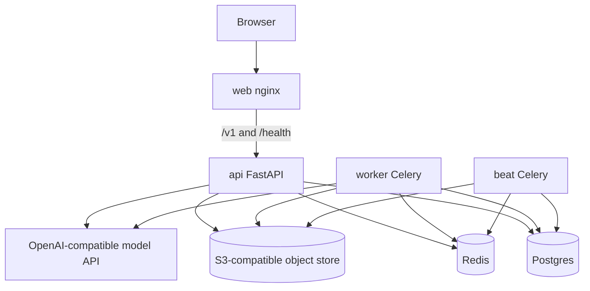

# Deploy

This app is four processes plus three data stores:

| Piece | Image / runtime | Role |
| --- | --- | --- |
| `web` | `apps/web/Dockerfile` (nginx) | SPA + same-origin proxy for `/v1` and `/health` |
| `api` | `infra/Dockerfile.backend` | FastAPI REST + WebSocket |
| `worker` | same backend image | Celery: transcription, scoring |
| `beat` | same backend image | Celery beat: retention, provider probes |
| Postgres 16 | managed or Compose | sessions, reports, users |
| Redis | managed or Compose | broker, rate limits, probe cache |
| S3-compatible bucket | MinIO, Tigris, R2, AWS S3, Railway Bucket | candidate audio, derivatives, examiner MP3 |

Pick a template:

| Where | Template |
| --- | --- |
| Your laptop | [README](../README.md#run-it-locally) / `docker compose up` |
| Any VPS or Kubernetes node | [`docker-compose.prod.yml`](../docker-compose.prod.yml) — [notes](../infra/deploy/docker.md) |
| Railway | [`infra/deploy/railway.md`](../infra/deploy/railway.md) |
| Render | [`infra/deploy/render.yaml`](../infra/deploy/render.yaml) — [notes](../infra/deploy/render.md) |
| Fly.io | [`infra/deploy/fly/`](../infra/deploy/fly/) |

Object storage is **S3-compatible**. You do not have to run MinIO in
production; set `MINIO_*` to R2, Tigris, AWS S3, or a Railway/Fly bucket.

## Shared production rules

1. Copy `.env.example` and fill real secrets. Never commit `.env`.
2. `APP_ENV=production` turns on the safety checks in `EnvironmentConfig`.
3. Generate `AUTH_TOKEN_SECRET` and `METRICS_TOKEN` with at least 32 random
   characters (`openssl rand -hex 32`).
4. Set `WEB_ORIGIN` to the public `https://` origin of **web** (the URL
   learners type). Leave `CORS_EXTRA_ORIGINS` empty when nginx proxies the API.
5. Point `DATABASE_URL`, `REDIS_URL`, and `CELERY_BROKER_URL` at managed
   services. `CELERY_BROKER_URL` may be the same Redis with a different DB
   index (`…/1`) or the same URL.
6. Create **one** bucket (or three). Keys do not collide across
   `MINIO_CANDIDATE_BUCKET`, `MINIO_DERIVATIVE_BUCKET`, and
   `MINIO_EXAMINER_BUCKET` if they share a bucket.
7. Configure models with [docs/models.md](models.md).
8. Run `alembic upgrade head` **before** serving traffic. Railway does this as
   `preDeployCommand`. Docker Compose production uses the `migrate` service.
   Never set `AUTO_MIGRATE=true` in production.
9. Run **exactly one** `beat` replica.
10. Web needs `API_UPSTREAM=<api-host>:<api-port>` so nginx can proxy `/v1`.
    Examples: `api:4000` (Compose), `api.railway.internal:4000` (Railway),
    `ielts-api.internal:4000` (Fly).

## Health

| URL | Meaning |
| --- | --- |
| `GET /health/live` | Process is up |
| `GET /health/ready` | Postgres, Redis, and the candidate bucket respond |
| `GET /health/providers` | Last STT/TTS probe (Bearer `METRICS_TOKEN`) |
| `GET /metrics` | Prometheus (same token) |

Point platform health checks at `/health/ready` on **api** and `/` on **web**.

## First-launch smoke test

1. Register, accept consent, complete the device check.
2. Run a short spoken test through all three parts.
3. Confirm a report opens.
4. `GET /health/ready` returns `ok` for postgres, redis, and storage.
5. `GET /health/providers` with the metrics token is healthy after the first
   beat probe (~30 minutes, or trigger `probe_providers` once).
