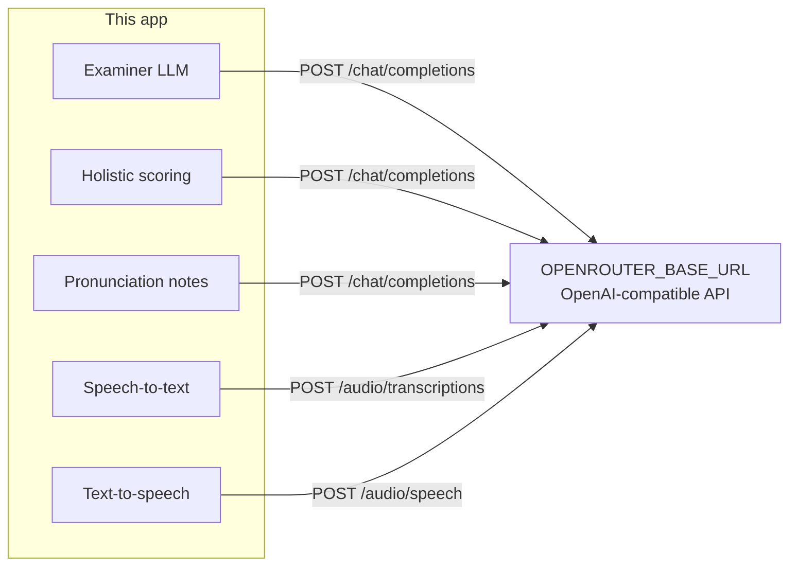

# Models and providers

The API, worker, and examiner talk to **one OpenAI-compatible HTTP API**.
By default that API is [OpenRouter](https://openrouter.ai). You can point the
same variables at Groq, Together, Fireworks, OpenAI, a self-hosted vLLM or
Ollama server, or any other gateway that implements the paths below.



## Required HTTP surface

| Job | Env var | HTTP path | Notes |
| --- | --- | --- | --- |
| Examiner questions | `REALTIME_LLM_MODEL` | `POST /chat/completions` | JSON object. Tried first, then scoring fallback, then scoring primary. |
| Band scoring | `OPENROUTER_SCORING_MODEL` | `POST /chat/completions` | Must return the scoring JSON schema. |
| Scoring fallback | `OPENROUTER_SCORING_FALLBACK_MODEL` | `POST /chat/completions` | Used when the primary scoring (or examiner) model fails. |
| Pronunciation notes | `OPENROUTER_PRONUNCIATION_MODEL` | `POST /chat/completions` | No fallback. Failure is non-fatal. |
| Transcription | `OPENROUTER_STT_MODEL` | `POST /audio/transcriptions` | Whisper-style `verbose_json` with word timestamps when the model supports them. |
| Transcription fallback | `OPENROUTER_STT_FALLBACK_MODEL` | `POST /audio/transcriptions` | |
| Examiner voice | `OPENROUTER_TTS_MODEL` | `POST /audio/speech` | Must return `audio/mpeg`. |
| TTS fallback | `OPENROUTER_TTS_FALLBACK_MODEL` | `POST /audio/speech` | Optional; leave empty to skip. |
| TTS voice id | `OPENROUTER_TTS_VOICE` | body field `voice` | Provider-specific (`alloy`, `af_heart`, `aura-asteria-en`, …). |

Shared credentials:

```
INFERENCE_MODE=openrouter
OPENROUTER_API_KEY=<token>
OPENROUTER_BASE_URL=https://openrouter.ai/api/v1
```

`OPENROUTER_*` names stay even when the host is not OpenRouter — they are the
adapter’s environment keys.

`REALTIME_STT_MODEL` / `REALTIME_TTS_MODEL` / `REALTIME_TTS_VOICE` are stored on
the live session for telemetry. **Transcription and speech HTTP calls always
use `OPENROUTER_STT_*` and `OPENROUTER_TTS_*`.** Set those if you want the
models to change.

## OpenRouter (default)

1. Create a key at [openrouter.ai/keys](https://openrouter.ai/keys).
2. Put it in `OPENROUTER_API_KEY`.
3. Pick slugs from [openrouter.ai/models](https://openrouter.ai/models).
4. Keep a few dollars of credit: some hosts refuse audio when the balance is
   near zero.

Copy-paste starting point (also in `.env.example`):

```env
OPENROUTER_BASE_URL=https://openrouter.ai/api/v1
OPENROUTER_STT_MODEL=qwen/qwen3-asr-0.6b
OPENROUTER_STT_FALLBACK_MODEL=openai/whisper-tiny
OPENROUTER_TTS_MODEL=hexgrad/kokoro-82m
OPENROUTER_TTS_FALLBACK_MODEL=deepgram/aura-2-arcas-en
OPENROUTER_TTS_VOICE=af_heart
OPENROUTER_SCORING_MODEL=google/gemma-3-27b-it
OPENROUTER_SCORING_FALLBACK_MODEL=google/gemma-3-12b-it:free
OPENROUTER_PRONUNCIATION_MODEL=google/gemma-3-12b-it:free
REALTIME_LLM_MODEL=google/gemma-3-12b-it:free
```

Useful OpenRouter families (check the catalogue; slugs change):

| Role | Examples |
| --- | --- |
| STT | `openai/whisper-large-v3-turbo`, `openai/whisper-large-v3`, `qwen/qwen3-asr-0.6b` |
| TTS | `openai/gpt-4o-mini-tts`, `hexgrad/kokoro-82m`, `deepgram/aura-asteria-en` |
| Scoring / examiner | `openai/gpt-4o-mini`, `google/gemma-3-27b-it`, `anthropic/claude-3.5-sonnet`, `meta-llama/llama-3.3-70b-instruct` |

Free-tier slugs often end with `:free` and are rate-limited. Always set a
fallback that you can pay for.

## Other hosted OpenAI-compatible APIs

Set `OPENROUTER_BASE_URL` to the vendor’s `/v1` root and `OPENROUTER_API_KEY`
to that vendor’s key. Model slugs are **that vendor’s** ids, not OpenRouter’s.

| Provider | Typical `OPENROUTER_BASE_URL` | Notes |
| --- | --- | --- |
| [OpenAI](https://platform.openai.com/docs/api-reference) | `https://api.openai.com/v1` | STT `whisper-1`, TTS `gpt-4o-mini-tts` or `tts-1`, chat `gpt-4o-mini`. |
| [Groq](https://console.groq.com/docs/openai) | `https://api.groq.com/openai/v1` | Fast chat + Whisper. Confirm TTS support before using it for examiner audio. |
| [Together](https://docs.together.ai/docs/openai-api-compatibility) | `https://api.together.xyz/v1` | Chat is strong; audio endpoints vary by model. |
| [Fireworks](https://docs.fireworks.ai/tools-sdks/openai-compatibility) | `https://api.fireworks.ai/inference/v1` | Chat completions. |
| [DeepInfra](https://deepinfra.com/docs/advanced/openai_api) | `https://api.deepinfra.com/v1/openai` | Chat + some Whisper models. |
| Azure OpenAI | `https://YOUR_RESOURCE.openai.azure.com/openai/v1` | Use a key or Entra token the gateway accepts as `Authorization: Bearer`. Deployment names become the `*_MODEL` values. |

Not every host implements `/audio/transcriptions` and `/audio/speech`. If a
host only does chat, keep STT/TTS on OpenRouter (or OpenAI) and point only the
scoring/examiner variables at the chat host — that requires **two adapters**,
which this codebase does not split today. Use one gateway that offers all three
jobs, or put a proxy (OpenRouter, LiteLLM, Cloudflare AI Gateway) in front.

## Self-hosted (vLLM, Ollama, LocalAI, LiteLLM)

Anything that speaks OpenAI `/v1` works:

```env
OPENROUTER_API_KEY=not-needed-but-must-be-nonempty
OPENROUTER_BASE_URL=http://ollama:11434/v1
OPENROUTER_SCORING_MODEL=llama3.1
OPENROUTER_SCORING_FALLBACK_MODEL=llama3.1
OPENROUTER_PRONUNCIATION_MODEL=llama3.1
REALTIME_LLM_MODEL=llama3.1
```

The client refuses to start without a non-empty `OPENROUTER_API_KEY`, even for
local servers that ignore it. Use any placeholder.

Ollama chat usually works. Ollama audio does **not** match Whisper/TTS unless
you add a separate speech service and a LiteLLM (or similar) router in front.

vLLM:

```env
OPENROUTER_BASE_URL=http://vllm:8000/v1
OPENROUTER_SCORING_MODEL=/models/your-instruct-checkpoint
```

## How to change one model

1. Look up the slug on the provider’s model list.
2. Set the matching env var on **api**, **worker**, and **beat** (they share
   config).
3. Restart those three processes. Examiner audio is cached by
   `(script, model, voice)` — a TTS change generates new files automatically.
4. Run `make evals` once against the new scoring/examiner pair before you
   trust production bands.

Example — Whisper large + GPT-4o mini scoring on OpenAI:

```env
OPENROUTER_BASE_URL=https://api.openai.com/v1
OPENROUTER_API_KEY=sk-...
OPENROUTER_STT_MODEL=whisper-1
OPENROUTER_STT_FALLBACK_MODEL=whisper-1
OPENROUTER_TTS_MODEL=gpt-4o-mini-tts
OPENROUTER_TTS_VOICE=alloy
OPENROUTER_SCORING_MODEL=gpt-4o-mini
OPENROUTER_SCORING_FALLBACK_MODEL=gpt-4o-mini
OPENROUTER_PRONUNCIATION_MODEL=gpt-4o-mini
REALTIME_LLM_MODEL=gpt-4o-mini
```

## Choosing models that behave well

- **STT** must return English text. Word timestamps improve fluency features;
  if the model only returns a string, scoring still runs with weaker acoustics.
- **TTS** must return MP3 (`audio/mpeg`). Voices are provider-specific — a
  Kokoro voice id will fail on OpenAI.
- **Scoring and examiner** need reliable JSON. Smaller free models wander;
  keep a stronger fallback.
- Do not put two unrelated jobs on the same tiny free model if you can avoid
  it — examiner latency is on the live path.

After changing prompts or models, re-record evals (`evals/README.md`) so CI
replay stays honest.
